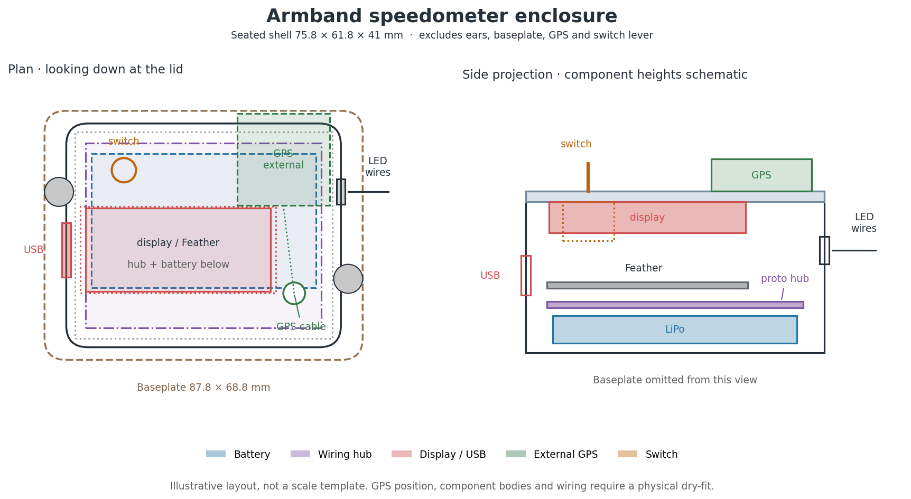

# Enclosure

The source is [`cad/enclosure.scad`](../cad/enclosure.scad). With the current
parameters, the seated shell is **75.8 × 61.8 × 41 mm**, excluding the screw ears,
baseplate, switch lever, and external GPS. The cavity is 71 × 57 × 36 mm; the
baseplate footprint is 87.8 × 68.8 mm.

The LiPo sits below the trimmed perma-proto and Feather/display stack. USB-C exits
the **−X (left) wall**; the three LED wires exit the **+X (right) wall**. The lid
has a display window, a 6.7 mm toggle-switch hole, and a 6 mm GPS cable hole. The
GPS mounts **outside**, antenna up, using two diagonal screws through holes
drilled during assembly. Its position and mounting holes are not defined in CAD.
There is no internal GPS retainer, antenna opening, switch guard, or charge-LED
window in the current model.



This is an illustrative layout, **not a full-size drilling or fit template**.
The GPS position and internal component heights are approximate; use the CAD and
actual parts for fit. A [larger diagram](../cad/enclosure_plan_slide.png) is also
available.

## Export and print

Render each `part` in OpenSCAD with F6 and export under the names below. Leave
`mount_features = false` for the plain shell used for initial fitting. Enabling
it adds a battery cradle to the base and Feather posts to the lid; check their
positions before printing both parts again.

| `part` selector | STL | Orientation | Suggested settings |
| --- | --- | --- | --- |
| `base` | [`base.stl`](../cad/base.stl) | Floor down, opening up | PETG, 0.2 mm layers, 3+ perimeters, 15–20% infill |
| `lid_print` | [`lid_print.stl`](../cad/lid_print.stl) | Outer face down; exported in this orientation | Same; features point up |
| `baseplate` | [`base_plate.stl`](../cad/base_plate.stl) | Underside down, locating rails up | Same; default `mount_radius = 10000` is nearly flat |

Start with supports off and add a 3–5 mm brim if needed. Check the slice preview,
especially the USB opening and the baseplate underside. Use the filament and
printer profiles appropriate to the machine. Re-export after changing parameters;
the checked-in STLs do not update automatically. The `assembled` preview lifts
the lid by 4 mm to show its mating lip; it is not the seated overall height.

## Fit parameters and checks

Print the plain base first and dry-fit the real boards, battery, and wiring before
committing to the lid and baseplate.

| Parameter | Current value | What to check |
| --- | --- | --- |
| `proto_l`, `proto_w` | 65 × 51 mm | Trimmed half-size perma-proto; this sets the required cavity footprint |
| `stack_x`, `stack_y` | −7, −4 mm | Display window and Feather alignment; USB is on the left |
| `stack_hang` | 22 mm | Display face to Feather PCB bottom; determines USB cutout height |
| `stack_envelope` | 27 mm | Display face to lowest header-tail tips; measure after soldering/trimming |
| `batt_l`, `batt_w`, `batt_h` | 62 × 37 × 7 mm | Actual cell, including wrapping and cable exit |
| `inner_l`, `inner_w`, `inner_h` | 71 × 57 × 36 mm | Room for the complete assembly, insulation, and wire bends |
| `disp_pkg_l`, `disp_pkg_w`, `disp_lip` | 50, 20, −2 mm | Produces a 54 × 24 mm display window |
| `usb_w`, `usb_h` | 15 × 10 mm | Connector and cable-plug clearance through the wall |
| `switch_x`, `switch_y`, `switch_hole_d` | −22, 18, 6.7 mm | Bushing/nut fit and internal body/terminal clearance |
| `gps_cable_x`, `gps_cable_y`, `gps_cable_d` | 25, −16, 6 mm | Cable route to the external GPS; check the connector passes through |
| `lip_clear` | 0.35 mm | Lid fit after printing; adjust for printer/material tolerances |

The nominal battery-to-tail clearance is only
`inner_h − stack_envelope − batt_h = 2 mm`. That is **before** any hub, solder,
felt, or wiring extending below those tail tips. Measure the complete stack and
raise `inner_h` if needed; do not use the lid to compress the LiPo. Recheck USB and
display alignment after adding foam or changing stack height.

The optional check reads the numeric dimensions from the SCAD source and redraws
the enclosure layout (requires Python and Matplotlib):

```sh
python3 cad/verify_fit.py
```

It checks nominal rectangular bounds, not corner collisions, the mating lip,
wires, fasteners, or measured assembly fit. Keep insulation between the battery
and every solder joint/header tail. Thread the LED cable through the base before
soldering it to the hub. For the remaining order of operations and the GPS service
loop, see [build guide: assembly](build.md#assembly).
